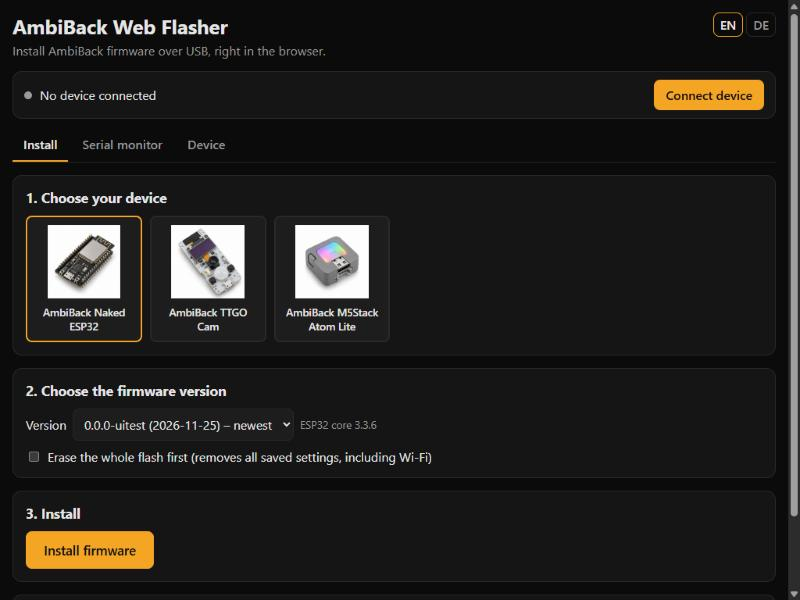
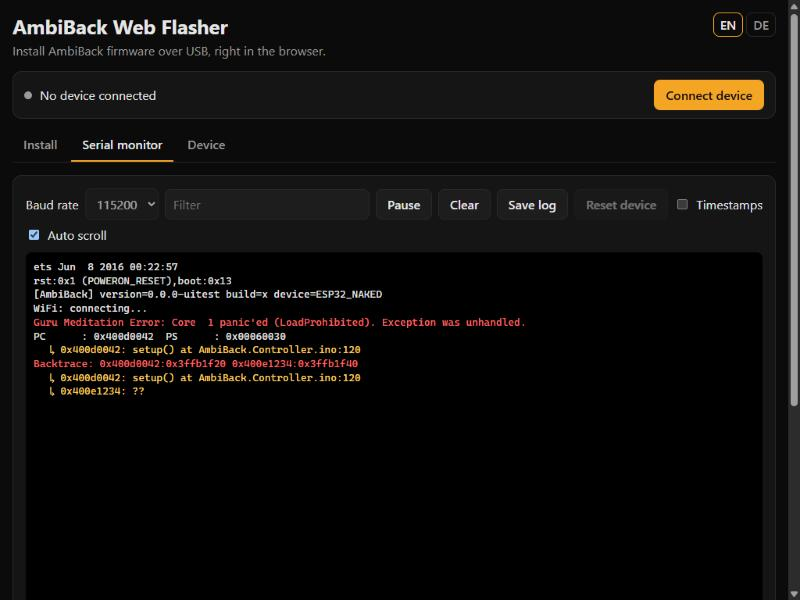

# AmbiBack Web Flasher

[English](README.md) · **Deutsch**

[AmbiBack](https://github.com/ambiback)-Firmware per USB auf einen ESP32 installieren, direkt im Browser. Ohne Arduino IDE, ohne esptool und ohne Windows-Programm.

**Öffnen:** https://ambiback.github.io/ambiback-web-flasher/

## Status

- Neues Projekt. Flashen, Monitor und WLAN-Einrichtung wurden **noch nicht mit echter Hardware getestet**.
- AmbiBack-Geräte werden seit etwa fünf Jahren nicht mehr verkauft. Das Tool ist für DIY-Nutzung gedacht, ohne Produkt-Support. Mehr unter [ambiback.de](https://www.ambiback.de/).

## Voraussetzungen

- **Chrome, Edge oder Opera auf einem Desktop-Computer** (Windows, macOS, Linux oder ChromeOS). Firefox, Safari sowie Smartphones und Tablets können von einer Webseite aus nicht auf serielle USB-Ports zugreifen.
- Ein USB-**Daten**kabel (viele Kabel laden nur).
- Unter Windows der USB-Treiber des Boards: [Silicon Labs CP210x](https://www.silabs.com/developers/usb-to-uart-bridge-vcp-drivers) oder [WCH CH340/CH9102](https://www.wch-ic.com/downloads/CH341SER_EXE.html). macOS und Linux bringen ihn meist mit.

## Firmware installieren

1. ESP32 an den Computer anschließen.
2. Web Flasher öffnen und das Gerät anhand der Bilder wählen.
3. Die neueste Version lassen oder eine ältere wählen.
4. **Firmware installieren** drücken und den USB-Port in der Liste des Browsers wählen.
5. Warten, bis der Fortschrittsbalken voll ist. Das Gerät startet neu.
6. WLAN-Name und Passwort eingeben, **Verbinden** drücken. Die Seite zeigt die Adresse des Geräts, sobald es online ist.

**Zuerst den ganzen Flash löschen** nur ankreuzen, wenn sich das Gerät nach einem Update seltsam verhält. Dabei gehen alle Einstellungen verloren, auch das WLAN.

## Serieller Monitor

Der Reiter **Serieller Monitor** zeigt, was das Gerät ausgibt. Filtern, Pausieren, Zeitstempel und Speichern als Textdatei sind möglich.

Stürzt das Gerät ab, zeigt der Monitor zu jeder Adresse des Backtrace die Funktion und die Quellzeile. Bei Firmware von dieser Seite geht das automatisch: Das Gerät gibt beim Start seine Version aus, und der Monitor lädt die passende Symboltabelle. Version und Gerät lassen sich auch von Hand wählen.

## Reiter Gerät

- **Info anzeigen**, **LED-Test**, **Neustart**, **Hardware-Reset**, **Werkseinstellungen** (mit Rückfrage)
- **Improv-Geräteinfo**: Firmware, Version, Chip und Name, bei Firmware mit Improv-Unterstützung
- **WLAN-Einstellungen**: WLAN jederzeit setzen oder ändern

## Fehlerbehebung

| Problem | Lösung |
|---|---|
| Die Port-Liste ist leer | Anderes Kabel und anderen USB-Port probieren. CP210x- oder CH340-Treiber installieren (Windows). Andere Programme schließen, die den Port nutzen: Arduino IDE, AmbiBack USB Flasher, Terminal-Programme. |
| „Der ESP32 hat nicht geantwortet“ | Manche Kamera-Boards haben keinen automatischen Boot-Modus. **BOOT** (IO0) halten, **RESET** (EN) kurz drücken, **BOOT** loslassen, dann neu starten. |
| Flashen bricht mittendrin ab | Der Flasher versucht es von selbst mit niedrigerer Geschwindigkeit. Hilft das nicht, ein kürzeres Kabel oder einen USB-Port direkt am Computer nehmen. |
| WLAN verbindet nicht | Name und Passwort prüfen (Groß-/Kleinschreibung). Der ESP32 kann nur 2,4-GHz-Netze. |
| „Dieser Browser kann nicht auf serielle USB-Ports zugreifen“ | Chrome, Edge oder Opera auf einem Desktop-Computer verwenden. |

Alles läuft im Browser. Das WLAN-Passwort geht per USB direkt an das Gerät und wird nirgendwo sonst hin gesendet.

## Funktionsweise

- Die Firmware wird von den GitHub Actions von [ambiback-firmware](https://github.com/ambiback/ambiback-firmware) für alle 13 Gerätetypen gebaut und bei jedem Release als `ambiback-firmware-<version>.zip` veröffentlicht.
- Der Deploy-Workflow dieses Repositorys kopiert die neuesten Releases in die Seite (`public/firmware/`), damit der Browser sie vom selben Ursprung lädt. Jede Datei wird vor dem Flashen gegen die SHA-256-Prüfsumme im Manifest geprüft.
- Geflasht wird mit [esptool-js](https://github.com/espressif/esptool-js) über [Web Serial](https://developer.mozilla.org/docs/Web/API/Web_Serial_API).
- Die WLAN-Einrichtung nutzt [Improv Wi-Fi Serial](https://www.improv-wifi.com/serial/). Ältere Firmware ohne Improv bekommt stattdessen den AmbiBack-Seriellbefehl `%WIFI:`.

Eigene Firmware mit eigenen Optionen bauen? Dafür gibt es den Windows-[AmbiBack USB Flasher](https://github.com/ambiback/ambiback-flasher).

## Entwicklung

Siehe [README.md](README.md#development).

## Lizenz

GPL-3.0, siehe [LICENSE](LICENSE). Fremdkomponenten: [THIRD_PARTY_NOTICES.md](THIRD_PARTY_NOTICES.md).
