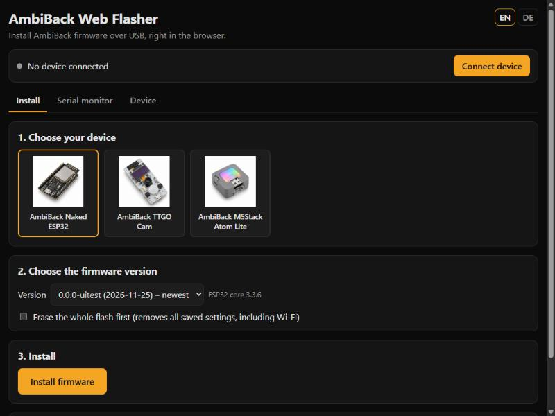
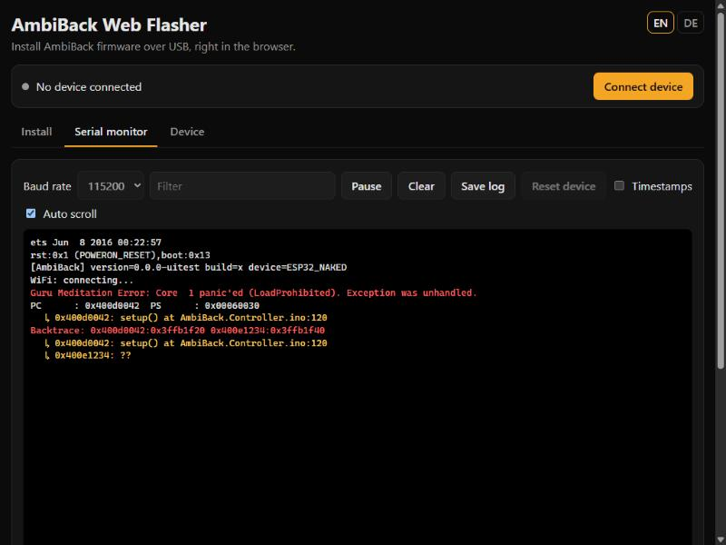

# AmbiBack Web Flasher

**English** · [Deutsch](README.de.md)

Install [AmbiBack](https://github.com/ambiback) firmware on an ESP32 over USB, right in the browser. No Arduino IDE, no esptool and no Windows program needed.

**Open it:** https://ambiback.github.io/ambiback-web-flasher/



## Status

- New project. The flashing, monitor and Wi-Fi code has **not been tested with real hardware yet**.
- AmbiBack devices have not been on sale for around five years. This tool is for DIY use, with no product support. More at [ambiback.de](https://www.ambiback.de/).

## What you need

- **Chrome, Edge or Opera on a desktop computer** (Windows, macOS, Linux or ChromeOS). Firefox, Safari and phones/tablets cannot access USB serial ports from a web page.
- A USB **data** cable (many cables only charge).
- On Windows the USB driver of your board: [Silicon Labs CP210x](https://www.silabs.com/developers/usb-to-uart-bridge-vcp-drivers) or [WCH CH340/CH9102](https://www.wch-ic.com/downloads/CH341SER_EXE.html). macOS and Linux usually have them built in.

## Install the firmware

1. Plug the ESP32 into the computer.
2. Open the web flasher and pick your device from the pictures.
3. Keep the newest version, or pick an older one.
4. Press **Install firmware** and choose the USB port in the browser's list.
5. Wait until the progress bar is full. The device restarts.
6. Enter your Wi-Fi name and password, press **Connect**. The page shows the address of the device when it is online.

Tick **Erase the whole flash first** only if the device behaves strangely after an update. It removes all saved settings, including Wi-Fi.

## Serial monitor

The **Serial monitor** tab shows what the device prints. You can filter, pause, show timestamps and save the log as a text file.

When the device crashes, the monitor shows the function and source line next to each address of the backtrace. This works automatically for firmware installed from this site: the device prints its version at boot, and the monitor loads the matching symbol map. You can also choose the version and device by hand.



## Device tab

- **Show info**, **LED test**, **Reboot**, **Hardware reset**, **Factory defaults** (asks first)
- **Improv device info**: firmware, version, chip and name, for firmware with Improv support
- **Wi-Fi settings**: set or change Wi-Fi at any time

## Troubleshooting

| Problem | What to do |
|---|---|
| The port list is empty | Try another cable and USB port. Install the CP210x or CH340 driver (Windows). Close other programs that use the port: Arduino IDE, AmbiBack USB Flasher, serial terminals. |
| "The ESP32 did not answer" | Some camera boards have no automatic boot mode. Hold **BOOT** (IO0), press and release **RESET** (EN), release **BOOT**, then start again. |
| Flashing stops in the middle | The flasher retries at lower speeds by itself. If it still fails, try a shorter cable or a USB port directly on the computer. |
| Wi-Fi does not connect | Check name and password (case matters). The ESP32 only supports 2.4 GHz networks. |
| "This browser cannot access USB serial ports" | Use Chrome, Edge or Opera on a desktop computer. |

Everything runs in your browser. The Wi-Fi password goes straight to the device over USB and is not sent anywhere else.

## How it works

- Firmware is built by the GitHub Actions of [ambiback-firmware](https://github.com/ambiback/ambiback-firmware) for all 13 device types and published as `ambiback-firmware-<version>.zip` on each release.
- The deploy workflow of this repository copies the newest releases into the site (`public/firmware/`), so the browser loads them from the same origin. Each file is checked against the SHA-256 in the manifest before flashing.
- Flashing uses [esptool-js](https://github.com/espressif/esptool-js) over [Web Serial](https://developer.mozilla.org/docs/Web/API/Web_Serial_API).
- Wi-Fi setup uses [Improv Wi-Fi Serial](https://www.improv-wifi.com/serial/). Older firmware without Improv gets the AmbiBack `%WIFI:` serial command instead.

Want to build your own firmware with your own options? Use the Windows [AmbiBack USB Flasher](https://github.com/ambiback/ambiback-flasher).

## Development

Requires Node.js 20 or newer.

```sh
npm install
npm run dev          # http://localhost:5173
npm test             # protocol unit tests
npm run lint
npm run build
```

Firmware for local testing:

```sh
node scripts/fetch-firmware.mjs                    # newest firmware releases
node scripts/fetch-firmware.mjs --zip ambiback-firmware-0.5.231.zip   # a CI artifact you downloaded
node scripts/fetch-firmware.mjs --run <run-id>     # artifact of an ambiback-firmware workflow run (needs gh)
```

In development builds, `window.__ambiback.feed('text\n')` feeds fake serial output into the monitor.

| Folder | Content |
|---|---|
| `src/serial/` | Web Serial session, esptool-js wrapper, AmbiBack commands, Improv |
| `src/debug/` | Backtrace decoding |
| `src/firmware/` | Firmware index, manifests, downloads with checksum check |
| `src/pages/` | Install, Serial monitor, Device |
| `scripts/fetch-firmware.mjs` | Copies firmware builds into `public/firmware/` |
| `test/` | Unit tests (`node --test`) |

The serial protocol is described in [ambiback-firmware/docs/serial-protocol.md](https://github.com/ambiback/ambiback-firmware/blob/main/docs/serial-protocol.md).

## License

GPL-3.0, see [LICENSE](LICENSE). Third-party components: [THIRD_PARTY_NOTICES.md](THIRD_PARTY_NOTICES.md).
